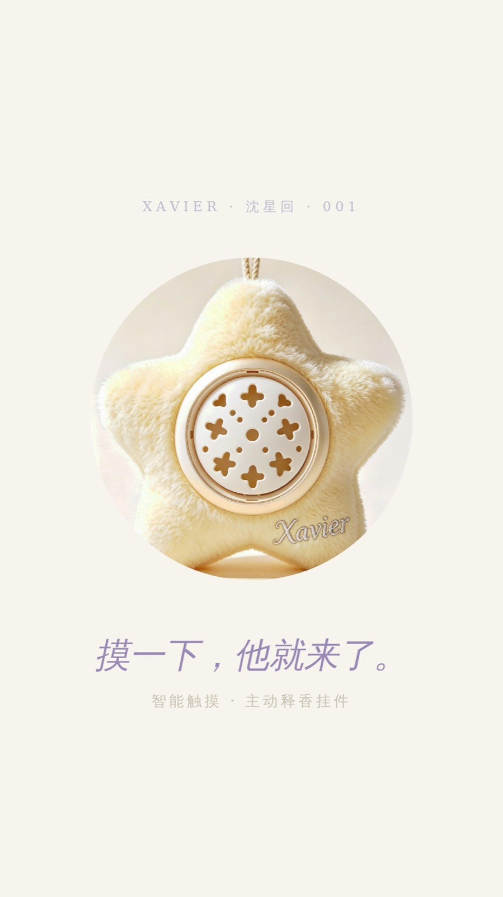
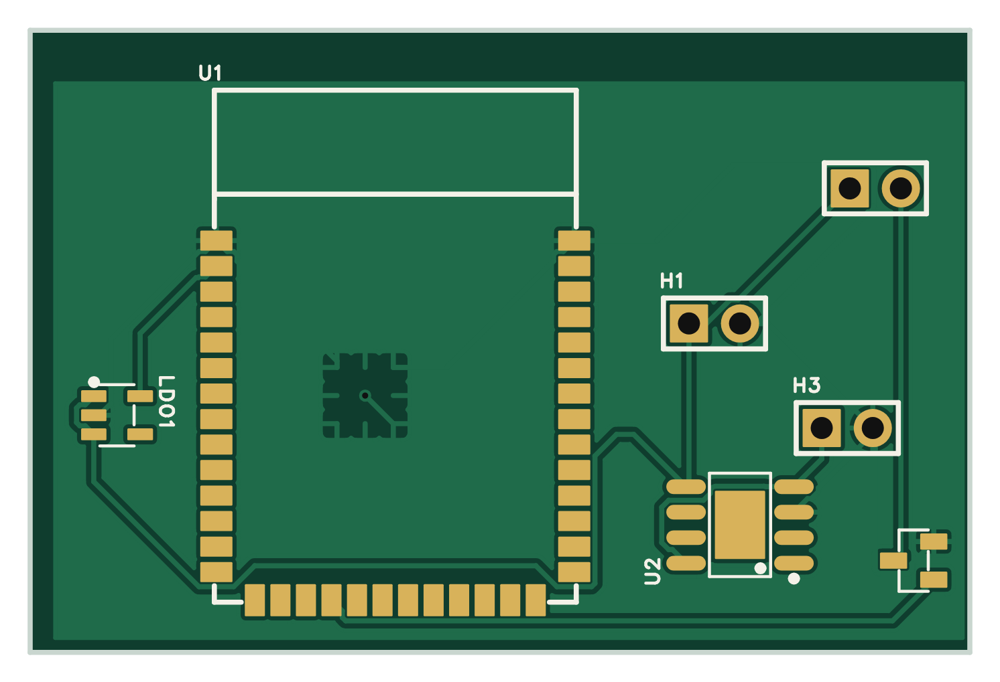
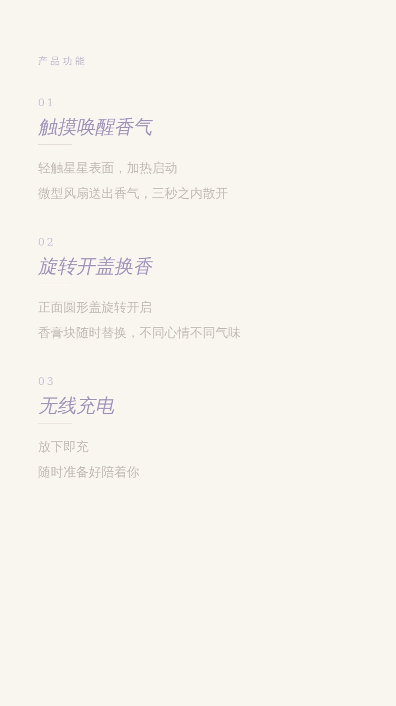
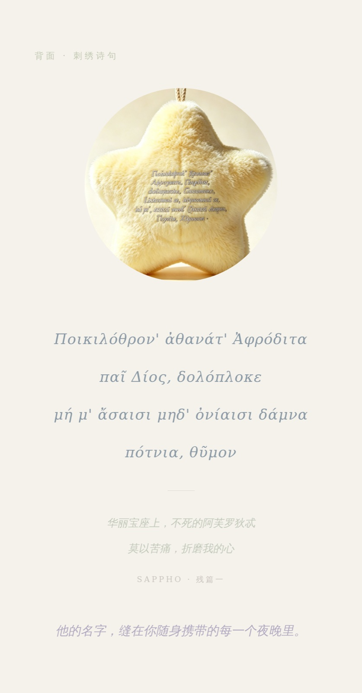
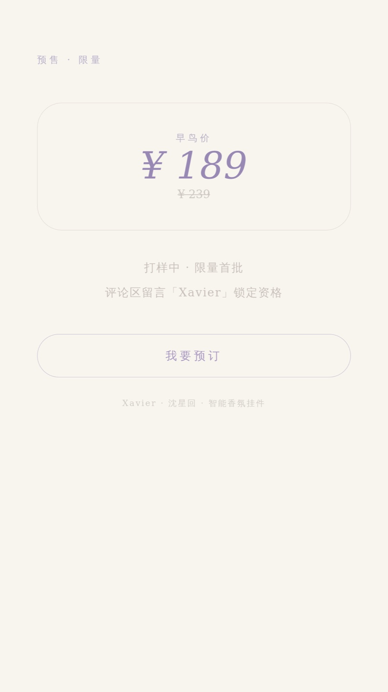
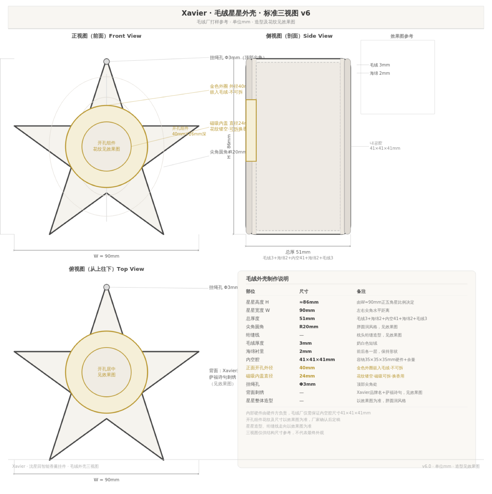
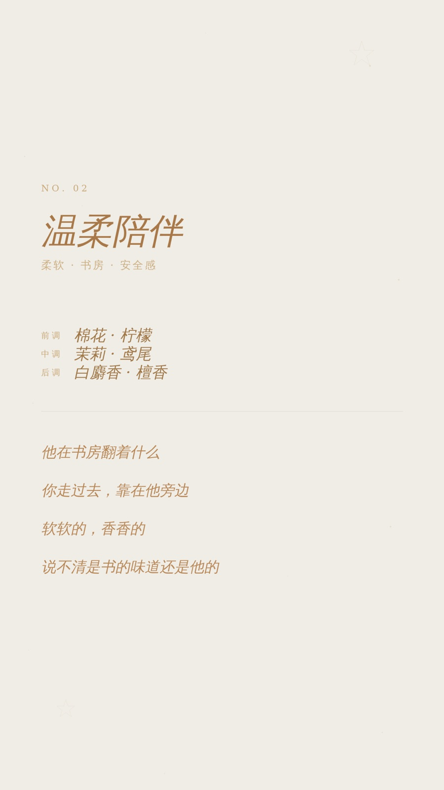
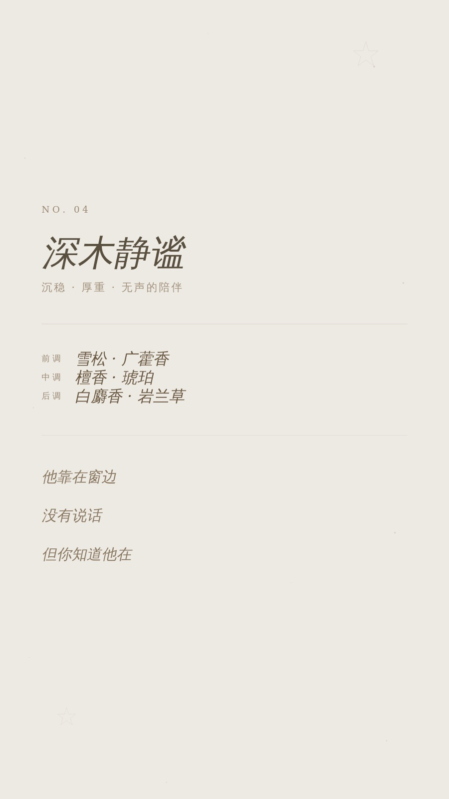
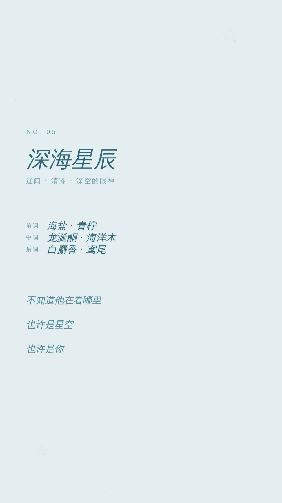

# Xavier · 沈星回智能气味挂件

**摸一下，他就来了。**

一款毛绒星星外形的智能香薰挂件：轻触释放香气，无线充电，旋开盖子更换香膏。为虚拟角色沈星回设计。

从电路、PCB、固件到外壳结构，全部由一个人独立完成，并做成了真实卖出、交付到用户手里的产品。

<p align="center">
  
  
  
</p>

---

## 它是怎么工作的

### 硬件框图

```
 Qi 无线充接收 ──5V──▶ TP4056 充电 ◀──▶ 3.7V 400mAh 锂电池
                          │ OUT+
              ┌───────────┼───────────────────┐
              ▼           ▼                   ▼
     ESP32-C3 Super Mini  (分压→GPIO3        MCH 陶瓷加热片
      │GPIO5      │GPIO6   低电量检测)        （5V，自身恒温 50 °C）
      ▼           └──────▶ SI2302 MOS 管 ──────┘
   TTP223 触摸 ◀── 铜箔电极（贴在毛绒内层）
```

加热片把香膏温热，香气从正面的金属出香面板散出来。MCH 陶瓷片自身恒温，MOS 管只负责通断。

### 固件状态机

```
[待机·深度睡眠] ──摸到──▶ 电量检查 ──▶ [加热 15 s] ──▶ [强制冷却 20 s·深度睡眠] ──▶ 手指松开后回到待机
                             │低电量
                             └──▶ LED 闪烁，不加热
```

- 不用时一直深度睡眠，只靠触摸脚唤醒，延长续航。
- 摸一下 = 固定加热一轮，时间由芯片计时决定，期间不理会触摸，时间到必停。
- 加热后强制冷却，冷却期间触摸无效：加热片有时间散热，香膏不会被连续触发过度挥发。
- 加热前电压低于 3.5V 不加热；加热中带载电压低于 3.3V 立即停。
- 只有确认手指松开（消抖）后才重新等待触摸，摸一下只触发一次。
- 所有时长、阈值、引脚都在 [`config.h`](config.h)。

历代固件和每一版的问题见 [`firmware_history.md`](firmware_history.md)。

| 参数（`config.h`） | 默认值 | 说明 |
|---|---|---|
| `HEAT_TIME_MS` | 15 000 | 每次触摸加热时长 |
| `COOLDOWN_TIME_MS` | 20 000 | 加热后强制冷却，期间触摸无效 |
| `TOUCH_STABLE_MS` | 100 | 消抖：低电平连续保持这么久才算松开 |
| `BATTERY_LOW_MV` | 3500 | 加热前低于此值不加热 |
| `BATTERY_CUTOFF_MV` | 3300 | 加热中低于此值立即停 |
| `FEATURE_FAN` | 0 | 风扇（GPIO7），v1.1 起默认关 |

关于加热时长：v1.5 源码里常量是 15 s，注释却写 30 s（沿用自更早版本）。本版取 **15 s**，代码和注释已统一；想改回 30 s 只需改 `config.h` 一行。

编译验证：已用 Arduino CLI + Arduino-ESP32 核心 3.3.11 对 `esp32:esp32:esp32c3` 编译通过（约 317 KB，24%）。v2.0 尚未在实物上重新验证；`platformio.ini` 未在本机实际运行。

## 物料清单（整机）

| 零件 | 型号 | 数量 |
|---|---|---|
| 主控 | ESP32-C3 Super Mini | 1 |
| 触摸 | TTP223 模块 + 导电铜箔 | 1 |
| 加热开关 | SI2302 N 沟道 MOS 管 | 1 |
| 加热元件 | MCH 陶瓷加热片 5V 恒温 50 °C | 1 |
| 充电管理 | TP4056（Type-C 版） | 1 |
| 无线充电 | Qi 接收模块 5V | 1 |
| 电池 | 3.7V 400mAh 锂电池 | 1 |
| 可选 | 微型风扇 5V + 第二颗 SI2302（v1.0 用过，v1.1 起去掉） | 1 |

完整 BOM（含 PCB 器件和建议加的保护件）：[`BOM.csv`](BOM.csv)
引脚表、PCB 说明、外壳尺寸、组装指南：[`hardware.md`](hardware.md)

| 引脚 | 接什么 |
|---|---|
| GPIO5 | TTP223 I/O（触摸输入 + 深睡眠唤醒） |
| GPIO6 | SI2302 栅极 → 加热片 |
| GPIO3 | 电池分压（可选，低电量保护） |
| GPIO7 | 风扇 MOS 管（可选） |
| GPIO8 | 板载 LED |

## 编译和烧录

**Arduino IDE**

1. 安装 Arduino-ESP32 开发板支持包 3.x。
2. 下载本仓库，把文件夹改名为 `xavier_pendant`（Arduino 要求文件夹名和 .ino 同名），打开 `xavier_pendant.ino`。
3. 开发板 **ESP32C3 Dev Module**，**USB CDC On Boot：Enabled**。
4. 按住 BOOT → 插 USB → 松开 BOOT → 上传。

**Arduino CLI**

```bash
arduino-cli compile --fqbn esp32:esp32:esp32c3:CDCOnBoot=cdc xavier_pendant
arduino-cli upload  --fqbn esp32:esp32:esp32c3:CDCOnBoot=cdc -p /dev/cu.usbmodemXXXX xavier_pendant
```

**PlatformIO**

```bash
pio run -t upload
pio device monitor
```

固件大部分时间在深度睡眠，USB 会断开；再次烧录时同样先按住 BOOT 再插线。

组装和接线：[`hardware.md`](hardware.md#组装指南)
PCB 下单：把 [`Gerber_Xavier_Pendant_PCB_2026-04-01.zip`](Gerber_Xavier_Pendant_PCB_2026-04-01.zip) 直接上传到嘉立创。

## 产品图

<p align="center">
  
  
  
  
</p>

<p align="center"><br>外壳三视图</p>

## 五款香气

<p align="center">
  
  
  
  
  
</p>

沈星回本味 · 温柔陪伴 · 清晨阳光 · 深木静谧 · 深海星辰

## 项目故事

2026 年初，我住在酒店里，把这个挂件从零做了出来：一个人画电路、画板、写固件、定外壳尺寸。2026 年 4 月 1 日，主控板定稿（嘉立创 EDA Pro，46.7 × 31 mm，双层板）。

固件前后改了很多版（v1.0 → v1.5，见 [`firmware_history.md`](firmware_history.md)）：先是去掉风扇，再加入深度睡眠，然后一直在和触摸芯片的两种工作模式较劲，最后改成“固定加热 → 强制冷却”的两段式，才彻底稳定下来。

产品定价 ¥189，单件成本约 ¥100。小红书上的一篇笔记拿到了 1,416 个赞（[笔记链接](http://xhslink.com/o/8nIdxbYDwCh)）。二十多笔预售已交付。

后来我主动停掉了它：这个产品需要很大的单量才能撑起成本，手工组装的人工也太重。它教会我的东西留了下来，这个仓库就是它的完整记录。

## 扩展：NeuroSync（概念原型）

> **只是概念原型，没有做成硬件。** 代码只在电脑上用模拟数据演示控制逻辑，不声称任何医疗、治疗或缓解症状的效果。

2025-12-17 的方案设想把挂件从“摸一下出香”扩展成“根据身体状态自动出香”：ESP32 + MAX30102（PPG 测心率）+ MPU6050（运动）+ 微流控雾化 + 200 mAh 电池，项圈形态。用心率变异性（HRV）大致判断当下状态，再选择气味和强度。项圈硬件没有做出来。

| 文件 | 说明 |
|---|---|
| [`neurosync_hrv_scent.py`](neurosync_hrv_scent.py) | 模拟心跳间期 → 计算 RMSSD → 判断状态 → 选择气味和 PWM 强度。阈值为演示随手设定，未经验证。运行：`python3 neurosync_hrv_scent.py` |
| [`neurosync_scent_control.py`](neurosync_scent_control.py) | MicroPython 出香 PWM 控制（修正了原始文件第 12 行的缩进错误） |
| [`neurosync_limbic_agent.py`](neurosync_limbic_agent.py) | 原始文件：“Limbic Agent”文字版原型，用关键词匹配情绪和时间段，打印要释放的配方 |

## 文件一览（全部在根目录）

| 文件 | 内容 |
|---|---|
| `xavier_pendant.ino` + `config.h` | 主固件 v2.0（Arduino / PlatformIO 通用） |
| `platformio.ini` | PlatformIO 工程配置（`src_dir = .`） |
| `firmware_history.md` | v1.0 ~ v1.5 原始代码和每一版的已知问题 |
| `hardware.md` | 引脚表、系统框图、PCB 说明、外壳尺寸、组装指南 |
| `BOM.csv` | 物料清单 |
| `Gerber_Xavier_Pendant_PCB_2026-04-01.zip` | PCB Gerber（2026-04-01 定稿） |
| `PickAndPlace_PCB1_2026-04-29.csv` | 另一版小板的贴片坐标（参考） |
| `pendant_*` / `pcb_top.png` / `enclosure_3view.png` / `scent_*.jpg` | 产品图、PCB 图、外壳三视图、香气卡片 |
| `neurosync_*.py` | HRV → 气味（概念原型） |

## 安全提示

- 加热片会发热：请在 MOS 栅极加下拉电阻，在加热支路串自恢复保险丝；软件保护不能完全替代硬件保护。
- 锂电池请使用带保护板的电芯，不要在无人看管时长时间充电。
- 这是一个消费类香薰挂件，不是医疗器械，不声称任何健康或治疗效果。

## 作者

时川懿，大一在读，自学硬件。

## 许可

代码以 [MIT License](LICENSE) 开源。图片、产品外观和“Xavier · 沈星回”相关名称不在 MIT 授权范围内。沈星回为游戏角色，本项目为个人创作，与角色版权方无关。

---

## English

**Xavier Scent Pendant** — a plush star-shaped smart scent pendant designed around the virtual character Xavier (沈星回). Touch it and it gently warms a solid perfume to release the scent; it charges wirelessly (Qi) and the scent cartridge is swapped by twisting off the cap.

- **Hardware:** ESP32-C3 Super Mini, TTP223 capacitive touch (GPIO5), SI2302 MOSFET (GPIO6) driving a 5 V self-regulating MCH ceramic heater, TP4056 charger, Qi receiver, 3.7 V 400 mAh Li-ion cell. Custom 2-layer PCB, 46.7 × 31 mm (Gerbers: `Gerber_Xavier_Pendant_PCB_2026-04-01.zip`).
- **Firmware:** deep sleep → touch wake → fixed 15 s heat phase → forced 20 s cool-down (timer-only wake, touch ignored) → wait for finger release → sleep. Low-battery lockout (3.5 V before heating, 3.3 V cut-off under load), release-debounced re-arming, heater pin held low during sleep. All parameters in `config.h`. Builds with Arduino-ESP32 core 3.x (`esp32:esp32:esp32c3`).
- **Story:** designed and built single-handedly by a self-taught student; priced at ¥189 with a unit cost of about ¥100; twenty-plus pre-orders delivered; later paused because it needed volume to cover cost and hand assembly was too labor-intensive.
- `neurosync_*.py` are an HRV-to-scent **concept prototype** only (simulated data, no hardware). Not a medical device; no health claims.

Code is MIT-licensed; images and character-related names are not covered.
