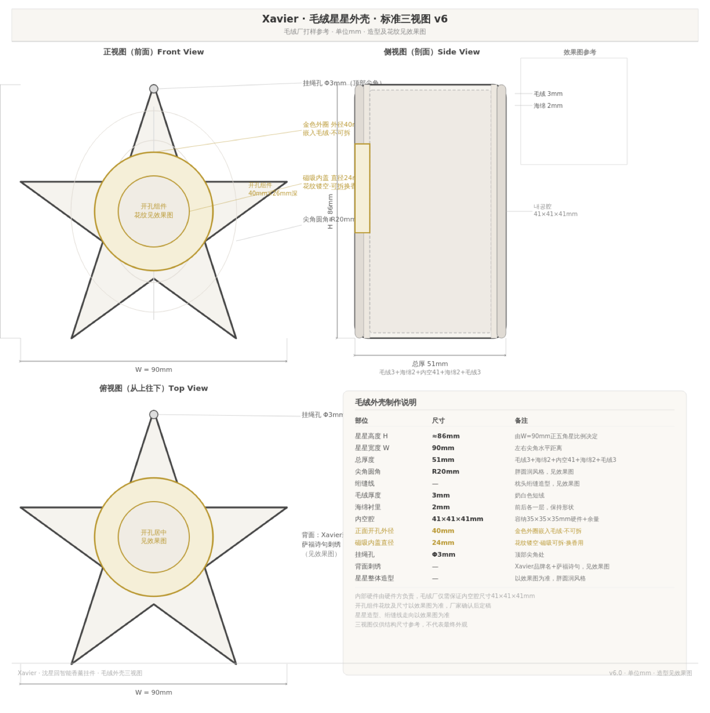

# 硬件：引脚、PCB、BOM、组装

## 文件

| 文件 | 内容 |
|---|---|
| [`Gerber_Xavier_Pendant_PCB_2026-04-01.zip`](Gerber_Xavier_Pendant_PCB_2026-04-01.zip) | 主控板 Gerber 定稿（嘉立创 EDA Pro 导出，2026-04-01）。46.7 × 31.0 mm，双层板。含钻孔和飞针测试文件，可直接上传嘉立创下单 |
| [`BOM.csv`](BOM.csv) | 物料清单：整机模块、可选件、建议加的保护件，以及 2026-04-01 主控板上的器件 |
| [`PickAndPlace_PCB1_2026-04-29.csv`](PickAndPlace_PCB1_2026-04-29.csv) | 原始贴片坐标表（由 xlsx 转成 CSV，内容未改） |
| 本页下方“另一版小板的器件清单” | 由上面的贴片坐标按器件归并出来的清单 |

> 关于贴片坐标表：这份贴片坐标（2026-04-29）对应的是另一版更小的板子（ESP32-C3 Super Mini + TP4056 + TTP224C + 两颗 SI2302），和 2026-04-01 的 Gerber 不是同一块板。那一版的 Gerber 没有放进仓库，这里只保留坐标表供参考。

## 引脚表（主固件 `xavier_pendant.ino`）

| 功能 | 器件 | ESP32-C3 Super Mini 引脚 | 说明 |
|---|---|---|---|
| 触摸输入 | TTP223 I/O | **GPIO5** | 摸到 = 高电平；同时作为深度睡眠唤醒源（C3 只有 GPIO0~5 能唤醒深睡眠） |
| 加热开关 | SI2302 栅极 | **GPIO6** | 低边开关；漏极接加热片一端，源极接 GND。建议栅极加 10 kΩ 下拉 |
| 加热元件 | MCH 陶瓷加热片 5V 恒温 50 °C | — | 一端接 TP4056 OUT+，另一端接 SI2302 漏极 |
| 电池检测（可选） | 分压电阻 | GPIO3（ADC1_CH3） | 电池正极 → 100k → GPIO3 → 100k → GND |
| 风扇（可选） | 第二颗 SI2302 栅极 | GPIO7 | v1.0 的接法；v1.1 起默认不用 |
| 板载 LED | Super Mini 自带 | GPIO8 | 低电平点亮；低电量时闪烁 |
| 供电 | TP4056 OUT+ / OUT- | 5V / GND | TP4056 B+/B- 接锂电池（3.7V 400mAh） |
| 充电输入 | Qi 接收模块 5V / GND | — | 接 TP4056 的 5V 输入焊盘；ID 脚悬空 |
| 触摸模块供电 | TTP223 VCC / GND | 3.3V / GND | 电极端接铜箔（贴在毛绒内层正面） |

## 系统框图

```
 Qi 无线充接收 ──5V──▶ TP4056 充电 ◀──▶ 3.7V 锂电池
                          │ OUT+
              ┌───────────┼──────────────────┐
              ▼           ▼                  ▼
     ESP32-C3 Super Mini  (分压→GPIO3)    MCH 陶瓷加热片
      │GPIO5      │GPIO6                     │
      ▼           └──────▶ SI2302 栅极 ──── 漏极
   TTP223 ◀── 铜箔电极          源极 → GND
```

## 2026-04-01 主控板（Gerber 里的这一块）

由飞针测试文件里的网表和 PCB 介绍整理：

- **U1** ESP32 Wi-Fi/蓝牙模组：天线伸出区域下方不铺铜、不走线；底部散热焊盘打过孔接地。
- **U2** TP4056（ESOP-8，带散热焊盘）：5V 从无线充电接收模块（H3）进来，给电池（H1）充电。
- **LDO1** 3.3 V 低压差稳压器（SOT-23-5）：电池直接供电，给主控。
- **Q1** N 沟道 MOS 管低边开关：由主控控制，驱动出香元件（H2，网络名 BAT+ / ATOM-）。
- 顶层一面贴片，便于嘉立创 SMT；顶层整片铺地；电源走粗线；接口都是 2.54 mm 排针，方便装进外壳后焊线。

注意：这块板上主控到 MOS 管栅极的连线是“模组第 18 焊盘”，具体对应哪个 GPIO 取决于所用模组的型号，网表里看不出来。焊好后请对照模组手册，把 `config.h` 里的 `PIN_HEATER` 改成对应的 GPIO。主固件的默认引脚按 ESP32-C3 Super Mini 飞线版本（GPIO5 / GPIO6）设置。

## 外壳

- 星星外壳 90 × 86 × 51 mm（早期组装指南写的是 90 × 90 mm，厚 51 mm）；内腔 41 × 41 × 41 mm
- 毛绒厚 3 mm，海绵衬里 2 mm
- 正面出香面板外径 40 mm，磁吸内盖 24 mm（旋开换香膏）
- 挂绳孔 Φ3 mm，在顶部



### 另一版小板的器件清单（由 PickAndPlace_PCB1_2026-04-29.csv 归并）

| 位号 | 器件 | 封装 | 层 | 数量 |
|---|---|---|---|---|
| H1 H2 H3 H4 | HDR-M_2.54_1x2P | HDR-TH_2P-P2.54-V-M-1 | B | 4
 |
| Q1 Q4 | SI2302-HXY | SOT-23-3_L2.9-W1.3-P1.90-LS2.4-BR | B | 2
 |
| R1 | 4.7K | R0603 | B | 1
 |
| R2 R3 | 10K | R0603 | B | 2
 |
| U1 | ESP32C3-SuperMini | COMM-SMD_16P-L22.5-W18.0-P2.54-TL | T | 1
 |
| U2 | TP4056 | ESOP-8_L4.9-W3.9-P1.27-LS6.0-BL-EP-1 | B | 1
 |
| H5 H6 H7 | HDR-M_2.54_1x1P | HDR-TH_1P-V-M_XKB_X4611WV-01I-C28D40 | B | 3
 |
| U4 | TTP224C-BSBN | SSOP-16_L4.9-W3.9-P0.64-LS6.0-BL | T | 1
 |

---

# 组装指南


> 整理自原始《Xavier 硬件组装指南 v1.0》。修正了原文件里几处录入错误的接线行；v1.0 的风扇接法保留为可选项。
> 固件已更新为 `xavier_pendant.ino`（深度睡眠 + 两段式加热/冷却 + 低电量保护），原文里的 v1.0 代码见 [`firmware_history.md`](firmware_history.md)。

### 一、零件清单

| 零件 | 型号 | 数量 |
|---|---|---|
| 主控板 | ESP32-C3 Super Mini | 1 |
| 触摸模块 | TTP223 | 1 |
| MOS 管 | SI2302 | 1（装风扇时 2） |
| 充电管理 | TP4056（Type-C 版） | 1 |
| 无线充电 | Qi 接收模块 | 1 |
| 锂电池 | 3.7V 400mAh | 1 |
| 加热片 | MCH 陶瓷 5V 恒温 50 °C | 1 |
| 风扇（可选） | 微型风扇 5V | 1 |
| 触摸电极 | 导电铜箔胶带（单导） | 约 80×80 mm |

建议另加：MOS 栅极 10 kΩ 下拉电阻、加热支路 PPTC 自恢复保险丝、两颗 100 kΩ 电池分压电阻（低电量保护用）。

### 二、接线

```
【供电】
电池(+)        → TP4056(B+)
电池(-)        → TP4056(B-)
TP4056(OUT+)   → ESP32-C3(5V)
TP4056(OUT-)   → GND

无线充电模块(5V)  → TP4056(Type-C 口上方焊盘)
无线充电模块(GND) → TP4056(Type-C 口下方焊盘)
无线充电模块(ID)  → 悬空不接

【触摸】
铜箔电极      → TTP223(电极端)
TTP223(VCC)   → ESP32-C3(3.3V)
TTP223(GND)   → GND
TTP223(I/O)   → ESP32-C3(GPIO5)

【加热片】
ESP32-C3(GPIO6) → SI2302(Gate)        （Gate 到 GND 加 10k 下拉）
SI2302(Drain)   → 加热片(线1)
加热片(线2)     → TP4056(OUT+)
SI2302(Source)  → GND

【电池检测（可选）】
TP4056(OUT+) → 100k → ESP32-C3(GPIO3) → 100k → GND

【风扇（可选，v1.0）】
ESP32-C3(GPIO7) → 第二个 SI2302(Gate)
SI2302(Drain)   → 风扇(负)
风扇(正)        → TP4056(OUT+)
SI2302(Source)  → GND
```

TTP223 请保持出厂默认：**直通模式、高电平有效**（TOG、AHLB 两个焊盘都不短接）。固件对自锁模式也做了兼容，但那样需要摸两下才触发一次。

### 三、内部布局

```
正面（出香孔）
    ↓
加热片（竖立）+ 香膏
    ↓
风扇（可选，居中，向前吹气）
    ↓
左下：锂电池
右下：ESP32-C3 + TP4056
背面：无线充电线圈
铜箔：贴在毛绒内层正面，约 80×80 mm
```

### 四、烧录（Mac，Arduino IDE）

1. 安装 Arduino-ESP32 开发板支持包（3.x）。
2. 下载本仓库，把文件夹改名为 `xavier_pendant`（Arduino 要求文件夹名和 .ino 同名），打开 `xavier_pendant.ino`。
3. 开发板选 **ESP32C3 Dev Module**，**USB CDC On Boot：Enabled**。
4. 端口选 `/dev/cu.usbmodem…`。
5. 按住 BOOT 键 → 插上 USB 线 → 松开 BOOT 键 → 点上传。

> 固件大部分时间在深度睡眠，USB 口会断开。之后再烧录时，同样先按住 BOOT 再插线。

### 五、测试

1. 飞线连接所有零件，上传固件。
2. 摸一下铜箔电极 → 加热片开始发热（串口打印“[加热]”）。
3. 15 秒后自动停止，进入 20 秒冷却；冷却期间再摸不会加热。
4. 冷却结束后再摸 → 又加热一轮。
5. （接了分压电阻时）把电池换成低于 3.5V 的 → 摸一下只闪灯、不加热。

### 六、产品尺寸

```
星星外壳    约 90×86 mm，厚 51 mm
内空腔      41×41×41 mm
毛绒厚度    3 mm
海绵衬里    2 mm
正面开孔    外径 40 mm，内盖 24 mm
挂绳孔      Φ3 mm，顶部
```
